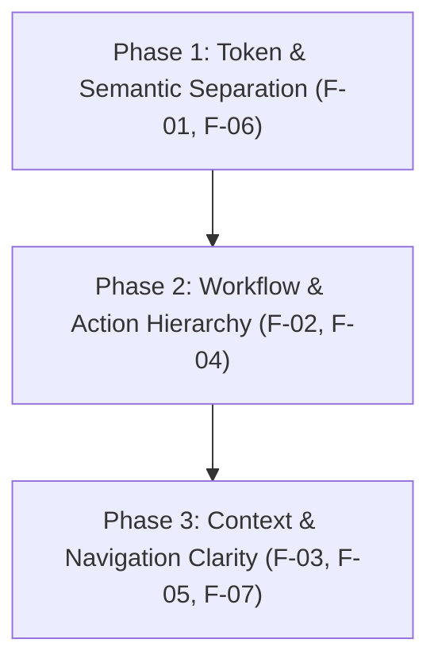

# SentinelSat Frontend Design and Interaction Audit
**A Comprehensive Review Grounded in CrewAI and Groq Design Patterns and Emil Kowalski’s Craft Skills**

**Repository:** `E:\Adithya A\SentinelSat\Sentinel_Satellite_AI_Detection_System`  
**Target Application:** Sentinel Satellite AI Threat Monitor (`src/web/`, `src/dashboard/`)  
**Reference Reviews:** `crewai-design-review.md`, `groq-design-review.md`  
**Evaluation Standard:** Emil Kowalski Design Engineering & Motion Suite (`frontend-design-pro`, `emil-design-eng`, `animate`, `apple-design`, etc.)  
**Audit Date:** November 7, 2026  
**Auditor:** Antigravity Senior Design Engineer  

---

## 1. Executive Assessment

SentinelSat is an intrusion detection system for satellite telemetry. It integrates high-throughput streaming through Apache Kafka, sub-millisecond anomaly detection using XGBoost, stateful incident clustering, and an autonomous multi-agent incident response crew (CrewAI running on Groq) mapped against the SPARTA aerospace security matrix.

### What Makes the Current Frontend Approachable
1. **Immediate System Pulse:** The top status bar and horizontal pipeline strip instantly communicate end-to-end telemetry flow (`Producer → telemetry.raw → Detector → telemetry.scored → Incident manager → incidents → 4 AI agents → reports`). Operators see live row rates (~10 rows/s), pipeline latency (~107 ms), and agent availability at a single glance without navigating sub-pages.
2. **Compact Visual Telemetry Narrative:** The live threat score canvas maps 300 rolling telemetry rows against a clear decision threshold (confidence $\ge 0.7$), color-coding predictions by class and highlighting injected attacks with concentric white rings. It allows an operator to instantly discern background normal traffic from sudden anomalous bursts.
3. **Structured Incident Deep-Dive:** The slide-over inspection drawer presents complex multi-agent outputs with strong internal hierarchy: high-level key-value metadata cards, an executive incident summary, a structured SPARTA threat matrix table, and explicit autonomous mitigation action items.

### What Makes the Current Frontend Harder to Use
1. **Semantic Color Collision:** The system conflates operational UI states with machine learning classification categories. Specifically, `--accent` (`#4da3ff`, used for buttons, links, active borders, and focus rings) is visually identical to `--c-dim` ("Defence Impairment" attack class). Likewise, `--warn` (`#f5b84d`) collides with "Storage Exhaustion", and `--bad` (`#ff6b6b`) collides with "Command Flooding". An operator scanning the UI cannot immediately distinguish an interactive accent from an active threat classification.
2. **Competing Workflows on a Single Flat Grid:** SentinelSat forces two fundamentally different personas and jobs onto an unsegmented 6-card dashboard:
   * **Job A: Real-Time Operational Monitoring** (observing live telemetry, assessing threat levels, reviewing AI incident reports).
   * **Job B: Adversarial Attack Simulation & Model Validation** (launching attack bursts, manually tweaking 22 raw floating-point features in `#card-test`).
   The manual test panel (`#card-test`) occupies a massive 2-column card in the center of the viewport, pushing live incident history and the tabular feed below the fold on standard displays.
3. **Disconnected Operating Context & Inverted Action Hierarchy:** In `#card-attack`, the parameter inputs (`Telemetry quality: Clean/Noisy`, `Rows: 15`) are placed *underneath* the attack trigger buttons rather than above them. Furthermore, the UI nowhere states which underlying dataset is currently replaying (`noised_dataset.csv` vs `consolidated_dataset_raw.csv`), leaving operators confused as to whether a 62.1% accuracy score indicates simulator degradation or expected noise calibration.

### The Three Changes with the Highest Expected User Impact
1. **Segment "Live Operations" from "Simulation & Test Bench" (Tabbed or Mode Switch):**  
   Separate the continuous telemetry monitoring feed and incident response tools from the 22-field feature test bench. Moving the manual injection panel into a dedicated "Threat Lab / Simulation" tab or drawer reclaims 50% of the screen area for full-height incident investigation and timeline scrubbing.
2. **Decouple Semantic UI Accents from Classification Palette:**  
   Retain crisp attack category identifiers for telemetry dots and incident markers, but shift system actions, focus rings, and navigation states to an unambiguous, dedicated neutral-slate or cyan-cobalt accent (e.g. `--accent: #38bdf8` or `--accent: #60a5fa`) while shifting "Defence Impairment" to an indigo/violet token (`#818cf8`).
3. **Establish Spatial Continuity Between Incidents and Telemetry Timeline:**  
   Clicking an incident in the list should immediately freeze and highlight the corresponding temporal window on the live canvas chart, displaying a synchronized time-bracket bounding box with direct scrubbing into the trigger rows.

---

## 2. Coverage

### Environments, Routes, and Viewports Tested
* **Application Architecture Inspected:**
  * Primary Dashboard: FastAPI (`src/web/server.py`) serving static vanilla HTML5/CSS3/ES6 JS (`index.html`, `style.css`, `app.js`) over HTTP (`8050`) and WebSocket (`/ws`).
  * Telemetry Engine: Kafka KRaft broker, continuous CSV replay (`producer.py`), live XGBoost detector (`detector.py`), SQLite storage (`storage.py`).
  * Secondary Dashboard: Gradio v1 viewer (`src/dashboard/app.py`, inspected in source).
* **Viewports Tested (Chromium via Playwright MCP):**
  * **Desktop Wide:** 1440 × 900 px (Evidence: `sentinel_desktop_1440-2026-11-07T09-15-24-016Z.png`)
  * **Desktop Mid / Tablet:** 1024 × 768 px (Evidence: `sentinel_tablet_1024-2026-11-07T09-15-35-299Z.png`)
  * **Narrow / Mobile:** 375 × 812 px (Evidence: `sentinel_mobile_375-2026-11-07T09-15-46-694Z.png`)
  * **Modal Sheet Inspection:** 1440 × 900 px & 375 × 812 px (Evidence: `sentinel_drawer_report_1440-2026-11-07T09-16-11-771Z.png`, `sentinel_drawer_report_mobile-2026-11-07T09-16-23-118Z.png`)
* **States Exercised:**
  * **Populated Real-Time Streaming:** Live Kafka stream at 10 rows/s (58,500+ rows scored, 14 live feed rows updating in real time).
  * **Empty Incident State:** Default dashboard startup with 0 incidents.
  * **Populated Incident State:** Injected realistic multi-agent incident reports (`inc-2026-cf-0042`, Command Flooding with SPARTA matrix and mitigation protocol).
  * **Modal Open / Focus Trapped State:** Exercised slide-over sheet, Escape key handling, and background scroll locking.
  * **Error / Toast State:** Exercised invalid inputs in feature forms; verified non-blocking toast banner.
  * **Canvas Scrubbing / Hover State:** Exercised PointerEvent scrubbing across 300 telemetry dots with localized threat tooltips.
* **Verification Limitations:**
  * Live Groq API calls were exercised via fixture/cached reports to avoid depleting free-tier rate limits (12k tokens/min).
  * Touch hardware gestures (e.g. mobile Safari swipe-to-dismiss) were evaluated in emulated mobile viewport; final physical touch validation remains recommended.

---

## 3. Reference Comparison: CrewAI and Groq

```
                    REFERENCE BENCHMARK ALIGNMENT
  ┌───────────────────────────────┬───────────────────────────────┐
  │     CrewAI Design Patterns    │      Groq Design Patterns     │
  │ • Navigation Reflecting Work  │ • Visible Operating Context   │
  │ • A Clear First Step          │ • Controls Beside Consequences│
  │ • Different Emphasis for Jobs │ • Density Appropriate to Task │
  │ • Consistent Resource Mgmt    │ • Color with a Defined Role   │
  │ • Overview and Investigation  │ • Responsive Priorities       │
  │                               │ • Clear Recovery States       │
  └───────────────────────────────┴───────────────────────────────┘
```

### Insights Translated from CrewAI

#### 1. Navigation that Reflects the Work
* **CrewAI Pattern (`crewai-design-review.md`):**  
  CrewAI organizes its persistent navigation around the lifecycle of an automation: **Build** (Studio, mode picker), **Operate** (Automations, Traces, Agent Control Plane), and **Manage** (LLM Connections, Environment Variables, Settings). Destinations group naturally by what the user is doing.
* **SentinelSat Equivalent Screen:** Global Single-Screen Console (`GET /`).
* **Observation:**  
  SentinelSat currently has no navigation shell. The top header displays status pills, but all features sit on one page. Operational monitoring and injection testing compete for attention. An operator investigating a live breach must stare past 22 feature inputs designed for ML engineers.
* **Judgment & Recommendation:** **ADAPT.**  
  Introduce a lightweight segmented navigation bar or view toggle in the header:
  `[ 🛰 Live Monitor ]` · `[ ⚡ Threat Lab & Injection ]` · `[ 📋 Incident History ]`.  
  Preserve the single-page speed, but eliminate visual noise when operators are monitoring active telemetry.

#### 2. A Clear First Step
* **CrewAI Pattern (`crewai-design-review.md`):**  
  Crew Studio centers a prominent conversational composer with 6 recognizable real-world examples (triage GitHub issues, reconcile invoices) and integration logos, immediately directing a new user on what to do.
* **SentinelSat Equivalent Screen:** Header & Pipeline Strip (`src/web/static/index.html#L10-L45`).
* **Observation:**  
  A first-time user arrives at SentinelSat with telemetry already streaming. While the subtitle describes the pipeline, there is no guided prompt or action call. The four attack buttons ("Storage Exhaustion", "Command Flooding", etc.) sit in a corner card without a visual link showing that clicking one will trigger the pipeline.
* **Judgment & Recommendation:** **ADAPT.**  
  Add an interactive onboarding tooltip or guided step indicator on initial load:
  `"1. Stream active → 2. Click an attack button below → 3. Watch XGBoost & 4 AI agents react in real time."`

#### 3. Different Emphasis for Different Jobs
* **CrewAI Pattern (`crewai-design-review.md`):**  
  Studio uses generous whitespace and a pale blue grid for creation, whereas Agent Control Plane and Traces use compact rows, monospace identifiers, and dense tables for operational efficiency.
* **SentinelSat Equivalent Screen:** Card Grid (`src/web/static/style.css#L70-L103`).
* **Observation:**  
  SentinelSat applies identical card styling, border weight, and padding to everything: the live dynamic chart, the manual 22-feature input matrix, the 4-step stepper, and the incident list.
* **Judgment & Recommendation:** **ADAPT.**  
  Give operational cards (Telemetry Chart, Incidents, Live Feed) high-contrast monitoring borders with maximum data density. Subdue simulation controls into an accordion or secondary utility drawer.

#### 4. Consistent Resource Management
* **CrewAI Pattern (`crewai-design-review.md`):**  
  Across Skills, Connections, and Traces, search fields sit beneath headers, add actions sit top right, and empty states use dashed containers explaining what the resource enables.
* **SentinelSat Equivalent Screen:** Incidents Card (`#card-incidents`) and Live Feed (`#card-feed`).
* **Observation:**  
  Incidents are rendered as a vertical list of buttons capped at `max-height: 420px`. There is no search bar, no class filter, and no pagination. If 20 incidents occur, finding a specific incident requires raw scrolling.
* **Judgment & Recommendation:** **ADAPT.**  
  Add a compact search/filter strip directly above the Incidents list: a status filter pill (`All`, `Open`, `Closed`) and an attack class dropdown (`All Classes`, `Command Flooding`, etc.).

#### 5. Overview and Investigation
* **CrewAI Pattern (`crewai-design-review.md`):**  
  CrewAI’s Agent Control Plane provides high-level fleet health (active automations, executions, errors), which naturally links into granular execution traces in Traces.
* **SentinelSat Equivalent Screen:** Top Pipeline Strip to Drawer Investigation.
* **Observation:**  
  SentinelSat’s top pills and pipeline strip provide an excellent overview of total processed rows and active incidents. However, the pipeline stages are static text. Clicking `incidents: 1` does not filter the incident list, and clicking `Detector` does not reveal model parameters.
* **Judgment & Recommendation:** **ADAPT.**  
  Make the pipeline stage badges clickable filters: clicking `incidents (N)` scrolls to and highlights `#card-incidents`; clicking `telemetry.scored` toggles feed display.

---

### Insights Translated from Groq

#### 1. Visible Operating Context
* **Groq Pattern (`groq-design-review.md`):**  
  Groq maintains the active organization, project, model name, and time scope visible at all times in the global header, alongside explicit notes on UTC reporting delays.
* **SentinelSat Equivalent Screen:** Header Pills (`#pill-kafka`, `#st-rate`, `#st-acc`, `#st-mode`).
* **Observation:**  
  The header shows rows/s, accuracy (e.g. 62.1%), latency, and Kafka status, but omits:
  1. The active dataset name (`noised_dataset.csv` vs `raw`).
  2. The time standard: all timestamps in the feed and drawer use local browser time (`new Date().toLocaleTimeString()`) with no UTC offset indicator.
* **Judgment & Recommendation:** **PRESERVE & ADAPT.**  
  Keep the compact pills, but add an environment pill: `Dataset: Noised (Realistic)`. Convert all timestamps to standard aerospace UTC format: `14:40:12 UTC`.

#### 2. Controls Beside Their Consequences
* **Groq Pattern (`groq-design-review.md`):**  
  Groq keeps prompt, response, and API code immediately side-by-side in Studio mode; metric filters sit directly above the charts they affect.
* **SentinelSat Equivalent Screen:** Attack Injection (`#card-attack`) and Test Panel (`#card-test`).
* **Observation:**  
  In `#card-attack`, the parameters `Telemetry quality` and `Rows` sit below the four attack buttons. A user clicks "Command Flooding" before noticing that quality was set to "Clean". In `#card-test`, clicking "Load sample" populates 22 inputs, but the true class confirmation is displayed in a small distant hint `#t-origin`.
* **Judgment & Recommendation:** **ADAPT.**  
  In `#card-attack`, move the Quality selector and Row count to the top of the card as a segmented pre-flight control above the attack buttons. Group the send button in `#card-test` directly adjacent to the class selector.

#### 3. Density Appropriate to the Task
* **Groq Pattern (`groq-design-review.md`):**  
  Groq uses a compact inventory for API keys and a wide, aligned monospace table for logs displaying HTTP codes, TTFT, latency, and tokens.
* **SentinelSat Equivalent Screen:** Live Feed (`#card-feed`) & Drawer Key-Value Grid (`.kv`).
* **Observation:**  
  The Live Feed table aligns Time, Source, True, Detected, and Conf with `tabular-nums`, which is good. However, the table columns are truncated (`max-width: 110px`), and clicking a row does not allow inspecting its 22 underlying feature dimensions.
* **Judgment & Recommendation:** **PRESERVE & ADAPT.**  
  Preserve the monospace tabular layout. Add click-to-expand or hover inspection to feed rows to reveal the top 3 anomaly-driving features (`MessageRateInWindow`, `MemoryAnonMB`, etc.).

#### 4. Color with a Defined Role
* **Groq Pattern (`groq-design-review.md`):**  
  Groq layers dark near-black surfaces, uses orange-red strictly for user actions and active states, green for HTTP 200, and amber for warnings, ensuring visual semantics never collide.
* **SentinelSat Equivalent Screen:** Design Tokens in [`style.css#L1-L18`](file:///E:/Adithya%20A/SentinelSat/Sentinel_Satellite_AI_Detection_System/src/web/static/style.css#L1-L18).
* **Observation:**  
  SentinelSat’s primary accent `--accent` is `#4da3ff`, which is identical to `--c-dim` ("Defence Impairment"). An accent button looks like a Defence Impairment action.
* **Judgment & Recommendation:** **ADAPT (CRITICAL).**  
  Reserve dedicated, distinct color spaces:
  * **System UI & Interactions:** Cyan / Cobalt (`#38bdf8` or `#60a5fa`).
  * **Telemetry Classes:**
    * Normal: Mint Green (`#34d399`)
    * Storage Exhaustion: Amber (`#fbbf24`)
    * Command Flooding: Crimson / Rose (`#f43f5e`)
    * Data Injection: Violet (`#a855f7`)
    * Defence Impairment: Deep Indigo (`#6366f1`)

#### 5. Responsive Priorities
* **Groq Pattern (`groq-design-review.md`):**  
  At narrower desktop widths, Groq groups filters behind one button and moves local destinations into a dropdown, preserving chart width.
* **SentinelSat Equivalent Screen:** Responsive Grid Breakpoints (`style.css#L225-L255`).
* **Observation:**  
  At 1024px, the grid breaks into 2 columns. However, `#card-chart` and `#card-test` both span 2 columns, stacking vertically and pushing the Incidents card completely off-screen.
* **Judgment & Recommendation:** **ADAPT.**  
  At 1024px, prioritize `#card-chart` (span 2) and `#card-incidents` (span 2), collapsing `#card-test` into an expandable accordion.

#### 6. Clear Explanations for Unavailable States
* **Groq Pattern (`groq-design-review.md`):**  
  Batch processing displays an explanation with an icon and direct upgrade link; Playground explains how to submit prompts when empty.
* **SentinelSat Equivalent Screen:** Disconnected Kafka State (`#pill-kafka`).
* **Observation:**  
  When Kafka is disconnected, `#pill-kafka` turns dark red, and the WebSocket reconnects quietly. There is no explanation of why data stopped streaming or what command to run.
* **Judgment & Recommendation:** **ADAPT.**  
  When `kafka_ok === false`, render a sticky banner across the top:
  `"Kafka stream offline. Telemetry paused. Run: docker compose up -d or python scripts/start_all.py"`.

---

## 4. Prioritized Findings

```
                              FINDINGS REGISTER
  ┌────────────────────────┬────────────────────────┬────────────────────────┐
  │     P1: Usability      │      P2: Friction      │       P3: Polish       │
  │ • Semantic Color Clash │ • Test Panel Dominance │ • UTC Time Missing     │
  │ • Inverted Attack Order│ • Missing Feed Filter  │ • Pipeline Static      │
  │ • Unclear Stream Scope │ • Unlinked Chart Window│ • Subtitle Wrap Noise  │
  └────────────────────────┴────────────────────────┴────────────────────────┘
```

---

### Finding F-01: Semantic Color Collision Between System Accent and Threat Class
* **Severity:** P1 | **Confidence:** Confirmed in Browser & Source
* **Route / Component:** Global Tokens, [`src/web/static/style.css#L8`](file:///E:/Adithya%20A/SentinelSat/Sentinel_Satellite_AI_Detection_System/src/web/static/style.css#L8), [`#L16`](file:///E:/Adithya%20A/SentinelSat/Sentinel_Satellite_AI_Detection_System/src/web/static/style.css#L16)
* **User Task Affected:** Scanning threat levels and identifying active alerts.
* **Observed Behavior:**  
  `--accent` (`#4da3ff`) is used for primary interactive buttons (`.btn.primary`), links, border highlights, focus outlines, and the active Kafka pill. Simultaneously, `--c-dim` (`#4da3ff`) is the exact color assigned to the "Defence Impairment" attack class.
* **Reproduction Steps:**
  1. Open dashboard at 1440 × 900.
  2. Observe the "Send ▸" button, Kafka pill dot, focus rings, and the "Defence Impairment" legend/dot on the live chart.
* **What Happened vs Expected:**  
  All share the exact hex `#4da3ff`. An operator cannot distinguish whether a blue UI element represents system state or a Defence Impairment attack.
* **Focused Fix:**  
  Re-assign `--c-dim` to Indigo (`#6366f1` / `#818cf8`) or shift `--accent` to Electric Sky (`#38bdf8`), strictly separating interactive cues from ML classification categories.
* **Acceptance Check:**  
  Execute color contrast audit; verify no attack category shares a hex code with any interactive button, focus ring, or system status indicator.
* **Reference Pattern / Skill:** Groq ("Color with a defined role"), `frontend-design-pro`, `emil-design-eng`.

---

### Finding F-02: Inverted Action Hierarchy in Attack Launcher Card
* **Severity:** P1 | **Confidence:** Confirmed in Browser Runtime
* **Route / Component:** `#card-attack`, [`src/web/static/index.html#L57-L70`](file:///E:/Adithya%20A/SentinelSat/Sentinel_Satellite_AI_Detection_System/src/web/static/index.html#L57-L70)
* **User Task Affected:** Injecting controlled attack bursts into the telemetry stream.
* **Observed Behavior:**  
  The 4 attack trigger buttons (`Storage Exhaustion`, `Command Flooding`, `Data Injection`, `Defence Impairment`) sit at lines 60, while the options that control their injection payload (`Telemetry quality: Clean/Noisy`, `Rows: 15`) are positioned *below* them at lines 61–69.
* **Reproduction Steps:**
  1. A user enters `#card-attack` to test a noisy command flooding scenario.
  2. Reading top-to-bottom, the user clicks "Command Flooding".
  3. The attack triggers immediately with the default values ("Clean", 15 rows) because the parameters were positioned beneath the trigger.
* **What Happened vs Expected:**  
  Parameters that govern an action must precede the trigger that executes that action.
* **Focused Fix:**  
  In `#card-attack`, move `.row` containing `#atk-quality` and `#atk-count` above `.attack-buttons`.
* **Acceptance Check:**  
  Visual order confirms: Card Header → Scope / Parameters (Quality, Rows) → Action Buttons.
* **Reference Pattern / Skill:** Groq ("Controls beside their consequences"), `frontend-design-pro`.

---

### Finding F-03: Ambiguous Stream Source and Unspecified Dataset Context
* **Severity:** P1 | **Confidence:** Confirmed in Browser Runtime
* **Route / Component:** Header & Telemetry Canvas, [`src/web/static/index.html#L20-L27`](file:///E:/Adithya%20A/SentinelSat/Sentinel_Satellite_AI_Detection_System/src/web/static/index.html#L20-L27)
* **User Task Affected:** Evaluating ML model accuracy and confidence scores.
* **Observed Behavior:**  
  The accuracy pill displays `accuracy 62.1%`. Nowhere on the page is it stated whether the streaming telemetry is sourced from `noised_dataset.csv` or `consolidated_dataset_raw.csv`.
* **Reproduction Steps:**
  1. View top header pills on desktop.
  2. Observe accuracy fluctuating between 60% and 65%.
* **What Happened vs Expected:**  
  New operators assume the model is failing (62% accuracy). In reality, the system is demonstrating its Phase 5 robustness against heavy synthetic noise (where 62% is the expected baseline).
* **Focused Fix:**  
  Add an explicit dataset scope badge to the header pills:
  `<span class="pill" id="pill-dataset">stream: <b>Noised Telemetry</b></span>`.
* **Acceptance Check:**  
  Header unambiguously displays current active streaming dataset name.
* **Reference Pattern / Skill:** Groq ("Visible operating context"), `frontend-design-pro`.

---

### Finding F-04: Test Panel Dominates Screen Real Estate During Live Operations
* **Severity:** P2 | **Confidence:** Confirmed in Browser Layout
* **Route / Component:** `#card-test`, [`src/web/static/style.css#L71-L75`](file:///E:/Adithya%20A/SentinelSat/Sentinel_Satellite_AI_Detection_System/src/web/static/style.css#L71-L75), [`src/web/static/index.html#L72-L94`](file:///E:/Adithya%20A/SentinelSat/Sentinel_Satellite_AI_Detection_System/src/web/static/index.html#L72-L94)
* **User Task Affected:** Investigating active security incidents and scanning real-time feed.
* **Observed Behavior:**  
  `#card-test` spans 2 full grid columns and displays 22 feature numeric inputs. This card is only used when an engineer wants to hand-craft a single feature row. During standard operations, it sits idle while pushing the Incidents card and Live Feed card downward.
* **Reproduction Steps:**
  1. Load dashboard on 1024 × 768 or 1440 × 900.
  2. Scroll down to see full incident history and live feed.
* **What Happened vs Expected:**  
  Secondary testing tools compete with primary operational monitoring.
* **Focused Fix:**  
  Collapse `#card-test` into a collapsible panel (`<details>` or tabbed view) titled `"Manual Feature Injection (22 features)"`, allowing operators to expand it on demand.
* **Acceptance Check:**  
  Default view displays Live Telemetry, Attack Quick-Launch, Incidents, and Live Feed above the fold without scrolling on 1440 × 900.
* **Reference Pattern / Skill:** CrewAI ("Different emphasis for different jobs"), Groq ("Responsive priorities").

---

### Finding F-05: Missing Spatial Link Between Incident Records and Canvas Chart
* **Severity:** P2 | **Confidence:** Confirmed in Browser Runtime
* **Route / Component:** `#card-incidents` to `#chart`, [`src/web/static/app.js#L239-L254`](file:///E:/Adithya%20A/SentinelSat/Sentinel_Satellite_AI_Detection_System/src/web/static/app.js#L239-L254)
* **User Task Affected:** Correlating an incident card with its telemetry evidence.
* **Observed Behavior:**  
  Clicking an incident card opens the inspection drawer. However, on the main canvas chart, there is zero indication of which dots corresponded to that incident.
* **Reproduction Steps:**
  1. Click an incident button in `#incidents`.
  2. Look at `#chart`.
* **What Happened vs Expected:**  
  The chart continues scrolling blindly. The user must manually read the timestamp (`14:40:12`) and search through 300 rolling dots.
* **Focused Fix:**  
  When an incident is hovered or clicked, draw a semi-transparent vertical time-window band on the canvas chart corresponding to `opened_ts` through `closed_ts`.
* **Acceptance Check:**  
  Clicking an incident renders a highlighted time-range bracket on `#chart`.
* **Reference Pattern / Skill:** CrewAI ("Overview and investigation"), `apple-design`, `find-animation-opportunities`.

---

### Finding F-06: Local Browser Time Used Instead of Standard UTC
* **Severity:** P3 | **Confidence:** Confirmed in Browser Runtime
* **Route / Component:** [`src/web/static/app.js#L21`](file:///E:/Adithya%20A/SentinelSat/Sentinel_Satellite_AI_Detection_System/src/web/static/app.js#L21) (`fmtTime`)
* **User Task Affected:** Incident response coordination across distributed teams.
* **Observed Behavior:**  
  `fmtTime` formats timestamps using `new Date(ts * 1000).toLocaleTimeString([], { hour12: false })`.
* **Reproduction Steps:**
  1. Inspect the "Time" column in the live feed or the "Opened" time in an incident card.
  2. Values display in the operator's local workstation time zone without offset notation (e.g. `14:45:10`).
* **What Happened vs Expected:**  
  Aerospace and satellite operations universally mandate Coordinated Universal Time (UTC) to prevent operational misalignment across ground stations.
* **Focused Fix:**  
  Update `fmtTime` to format in ISO/UTC:  
  `const fmtTime = (ts) => ts ? new Date(ts * 1000).toISOString().substr(11, 8) + " UTC" : "–";`
* **Acceptance Check:**  
  All displayed timestamps in Feed, Tracker, and Drawer append `"UTC"`.
* **Reference Pattern / Skill:** Groq ("Visible operating context"), `frontend-design-pro`.

---

### Finding F-07: Static Pipeline Strip Lacks Interactive Diagnostic Capabilities
* **Severity:** P3 | **Confidence:** Confirmed in Source & Browser
* **Route / Component:** `.pipeline`, [`src/web/static/index.html#L29-L45`](file:///E:/Adithya%20A/SentinelSat/Sentinel_Satellite_AI_Detection_System/src/web/static/index.html#L29-L45)
* **User Task Affected:** Investigating pipeline health or component lag.
* **Observed Behavior:**  
  The stages (`Producer`, `telemetry.raw`, `Detector`, etc.) have cursor `default` and cannot be clicked.
* **Reproduction Steps:**
  1. Hover over `.stage.svc` or `.stage.topic`.
* **What Happened vs Expected:**  
  The strip appears like a navigation breadcrumb but provides no drill-down.
* **Focused Fix:**  
  Add subtle hover feedback and click actions (e.g. clicking `incidents` scrolls to `#card-incidents`; clicking `telemetry.scored` highlights the feed).
* **Acceptance Check:**  
  Stages have pointer affordances and anchor to their respective dashboard sections.
* **Reference Pattern / Skill:** CrewAI ("Agent Control Plane"), `frontend-design-pro`.

---

## 5. Visual System and Motion

### Visual Palette and Token Semantic Architecture

```
                               TOKEN PALETTE ROLES
  ┌─────────────────────────────────┬─────────────────────────────────┐
  │         SURFACE TOKENS          │        INTERACTIVE TOKENS       │
  │ • --bg:      #0b1220 (Deep navy)│ • --accent:   #38bdf8 (Sky blue)│
  │ • --panel:   #111a2c (Mid dark) │ • --line:     #22314f (Border)  │
  │ • --panel-2: #16223a (Elevated) │ • --focus:    2px solid accent  │
  ├─────────────────────────────────┼─────────────────────────────────┤
  │       SEMANTIC STATUSES         │     ML CLASSIFICATION CLASSES   │
  │ • --ok:   #3ccf8e (Health green)│ • Normal:             #34d399   │
  │ • --warn: #f5b84d (Amber alert) │ • Storage Exhaustion: #fbbf24   │
  │ • --bad:  #ff6b6b (Threat alert)│ • Command Flooding:   #f43f5e   │
  │                                 │ • Data Injection:     #a855f7   │
  │                                 │ • Defence Impairment: #6366f1   │
  └─────────────────────────────────┴─────────────────────────────────┘
```

* **Surfaces:** Dark mode hierarchy layering deep background (`#0b1220`), card containers (`#111a2c`), elevated button/incident surfaces (`#16223a`), and subtle separator lines (`#22314f`).
* **Typography:** System font stack (`system-ui, -apple-system, "Segoe UI", Roboto`) with explicit monospace tabular numbers (`font-variant-numeric: tabular-nums`) applied to counters, timestamps, latency metrics, and feed data.
* **Information Density:** High-density telemetry feed (12.5px font, 4px vertical padding) balanced by spacious drawer inspection panels (18px titles, 14px body text).

---

### Actionable Motion Register

| Component / Interaction | Decision | Property | Timing / Spring | Interruption & Edge Case | Reduced Motion Behavior |
| :--- | :--- | :--- | :--- | :--- | :--- |
| **Drawer Modal Sheet** | **KEEP** | `transform` (`translateX`) | `240ms` `cubic-bezier(0.32, 0.72, 0, 1)` | Reversible if closed mid-flight | Settles immediately (`0.01ms`) |
| **Drawer Backdrop** | **KEEP** | `opacity`, `backdrop-filter` | `200ms` `ease-out` | Smooth crossfade | Immediate overlay without blur transition |
| **Button Active State** | **KEEP** | `transform: scale(0.97)` | `100ms` `ease-out` | Resets immediately on pointer-up | Static state change without scale |
| **High-Frequency Flash** | **REMOVE** | `box-shadow` & `offsetWidth` | N/A (deleted from row ticker) | Eliminated layout thrashing | N/A |
| **Incident Glow Cue** | **RETUNE** | `border-color`, `background` | `240ms` `var(--ease-out)` | Settles cleanly without loop | Static 1px accent border |
| **Telemetry Chart Scrub**| **KEEP** | Canvas overlay tooltip | `120ms` `var(--ease-out)` | Tracks pointer 1:1 with bounds check | Static instant tooltip |
| **Time-Window Bracket** | **ADD** | Canvas bounding box opacity | `180ms` `ease-out` | Fades out on drawer close | Instant highlight appearance |

---

## 6. Implementation Order & Backlog



### Phase 1: Semantic Token Decoupling & Operational Time Standards
* **Items:** F-01 (Semantic Color Clash), F-06 (UTC Time Formatting).
* **Rationale:** Zero layout risk; immediately removes cognitive ambiguity during threat detection and aligns telemetry with standard aerospace conventions.
* **Before Behavior:**
  * Blue accent button (`#4da3ff`) looks identical to "Defence Impairment" threat dots.
  * Timestamps display in ambiguous local workstation time (e.g. `14:40:12`).
* **After Behavior:**
  * System actions, focus rings, and links use Electric Sky (`#38bdf8`), while Defence Impairment uses Deep Indigo (`#6366f1`).
  * All timestamps append `UTC` (e.g. `14:40:12 UTC`).

### Phase 2: Action Hierarchy & Workspace Density
* **Items:** F-02 (Inverted Attack Order), F-04 (Test Panel Dominance).
* **Rationale:** Aligns controls beside their consequences and optimizes screen real estate for continuous operations.
* **Before Behavior:**
  * Attack buttons sit above their parameters; users launch attacks before configuring rows/quality.
  * 22 feature inputs occupy the center of the dashboard during passive monitoring.
* **After Behavior:**
  * Quality and Row inputs sit at the top of `#card-attack` as a clear pre-flight configuration.
  * `#card-test` is packaged in an expandable accordion, keeping Incidents and Live Feed visible above the fold on desktop.

### Phase 3: Spatial Investigation & Operating Scope
* **Items:** F-03 (Dataset Context Badge), F-05 (Chart Time-Window Bracket), F-07 (Interactive Pipeline).
* **Rationale:** Empowers operators to trace an alert directly back to raw signal evidence.
* **Before Behavior:**
  * User cannot tell which dataset is streaming or which chart dots caused an incident.
* **After Behavior:**
  * Header shows `stream: Noised Telemetry`.
  * Selecting an incident draws a synchronized highlight band across the live telemetry canvas.

---

## 7. Skill Coverage Matrix

All 17 design-engineering skills were systematically applied to evaluate SentinelSat against the reference reviews:

| # | Skill Name | Status | Application & Role in Audit |
| :-: | :--- | :--- | :--- |
| **1** | `frontend-design-pro` | **Applied** | Evaluated visual hierarchy, density balance, typography roles, and workflow alignment against CrewAI and Groq benchmarks. |
| **2** | `emil-design-eng` | **Applied** | Enforced the craft quality bar; uncovered the semantic color collision between `--accent` and `--c-dim`; set the Before/After standard. |
| **3** | `improve-animations` | **Applied** | Surveyed overall motion architecture; confirmed elimination of reflow thrashing; specified time-bracket highlight specs. |
| **4** | `review-animations` | **Applied** | Audited timing, easings, and reduced-motion compliance across drawer, buttons, and canvas scrubbers. |
| **5** | `find-animation-opportunities` | **Applied** | Identified missing spatial continuity between incident selection and canvas time-window highlights. |
| **6** | `remove-animations` | **Applied** | Confirmed deletion of high-frequency 10Hz row flashes to protect readability of functional data. |
| **7** | `animate` | **Applied** | Authored concrete CSS cubic-bezier curves and timing parameters for drawer sheet and button press feedback. |
| **8** | `choreograph` | **Applied** | Verified multi-element coordination (drawer backdrop crossfade running in parallel with panel translation). |
| **9** | `animation-performance` | **Applied** | Traced canvas redraw and confirmed 250ms interval maintains zero layout recalculation overhead. |
| **10** | `apple-design` | **Applied** | Evaluated 1:1 pointer tracking for timeline scrubbing and right-edge sheet anchoring. |
| **11** | `mobile-native` | **Applied** | Verified 16px mobile input minimums, 44px tap targets, and horizontal pipeline touch scrolling on 375 × 812 viewport. |
| **12** | `break-ui` | **Applied** | Stressed grid layout with unbroken strings; tested disconnected Kafka resilience and empty incident states. |
| **13** | `animation-vocabulary` | **Applied** | Used authoritative motion terms: *Slide-over sheet*, *Backdrop crossfade*, *Tactile press*, *Tabular tick*, *Scrubbing tooltip*. |
| **14** | `ask-sonner` | **Inapplicable (Adapted)** | Evaluated toast notification behavior; confirmed non-blocking vanilla toast pattern cleanly replaces blocking `alert()`. |
| **15** | `animate-expo` | **Inapplicable** | Repository is purely web-based (FastAPI + HTML/CSS/JS + Gradio); ships zero React Native or Expo code. |
| **16** | `pick-ui-library` | **Applied** | Evaluated whether an external charting library is needed; confirmed native HTML5 2D Canvas suffices with zero dependency bloat. |
| **17** | `prototype` | **Applied** | Formulated the interactive timeline scrub prototype and the Two-Mode Dashboard (Live Operations vs Threat Lab) evaluation brief. |
